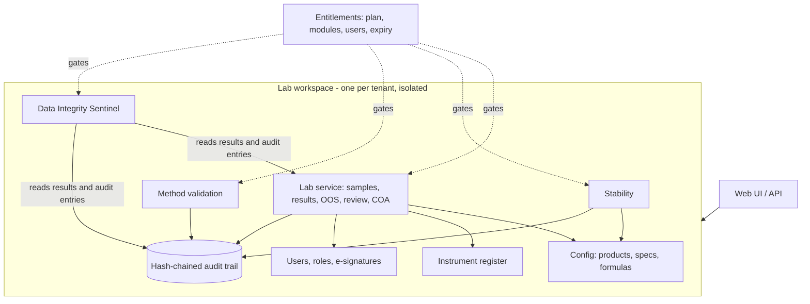
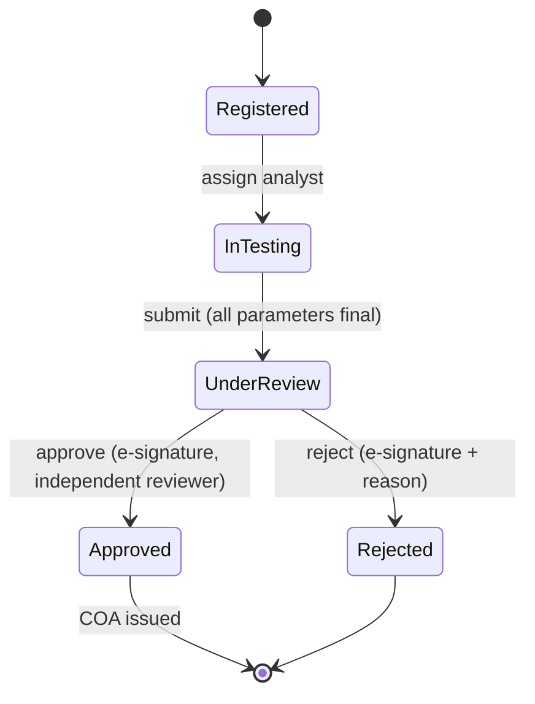
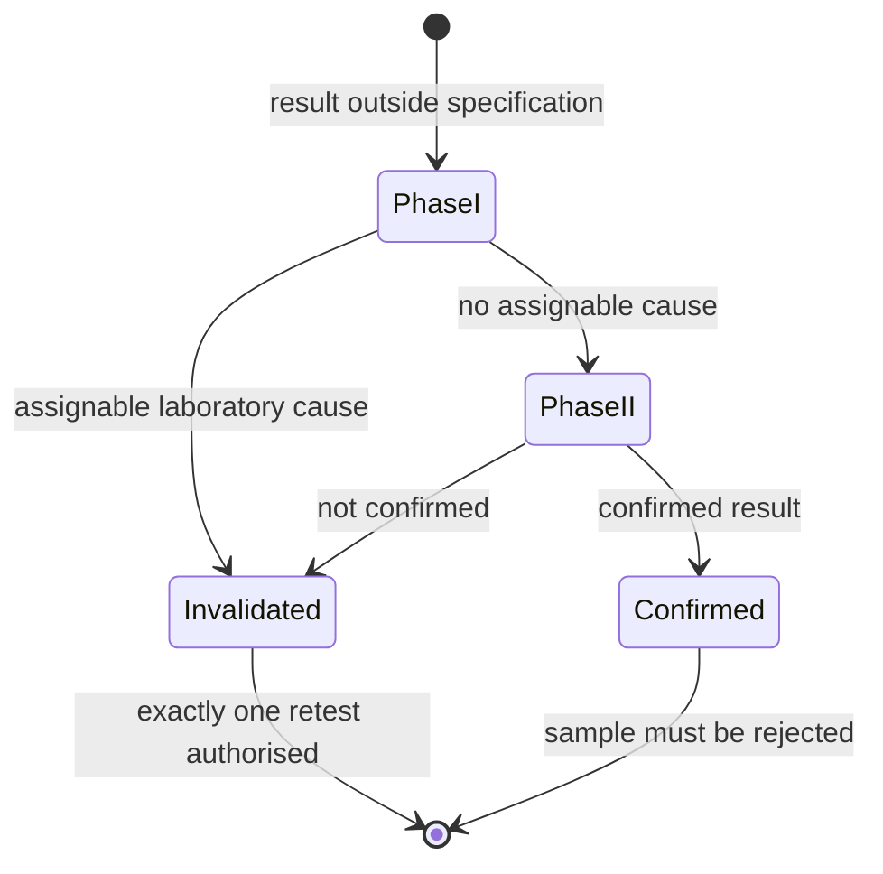

# LabSentinel LIMS: System Design

## 1. Purpose

A configurable LIMS for GxP laboratories (pharmaceutical, food, chemical, cosmetics, testing labs).
Labs define their own products, specifications, methods, and limits as **data**; the platform enforces
the rules that make the results defensible in an inspection.

Differentiator: a **Data Integrity Sentinel** that turns the audit trail from a passive log into an
active, continuous review.

## 2. Architecture

Isolation is structural: every lab gets its own workspace (users, catalog, samples, audit chain), so
there is no `tenant_id` filter to forget. In a database-backed build, the equivalent is row-level security.

## 3. Domain rules enforced by the core

| Rule | Where |
|---|---|
| Results are rounded half-up to the specification's decimals *before* comparison to limits | `formula.Specification` |
| Specifications are versioned; each sample pins the version it was registered under | `config`, `lab` |
| Instruments must be in service and within calibration on the day of use | `instruments`, `lab.enter_result` |
| Only the assigned analyst can enter results (attributable data) | `lab.enter_result` |
| A passing result can never be retested ("no testing into compliance") | `lab.enter_result` |
| An OOS result opens an investigation automatically; no retest until it authorises one | `oos`, `lab` |
| Investigator must be independent of the original analyst; conclusions are e-signed | `lab.conclude_*` |
| A confirmed OOS can never be approved, and no COA can be issued for it | `lab.approve`, `lab.issue_coa` |
| Reviewer cannot be an analyst on the same sample (segregation of duties) | `lab._review_gate` |
| COA carries a SHA-256 hash; `verify_coa` detects any alteration | `lab.issue_coa` |
| Failed signature attempts are audited | `lab._sign` |
| Everything is written to an append-only, hash-chained audit trail | `audit` |

### Sample lifecycle

### OOS investigation

## 4. Data Integrity Sentinel

Inspection findings on data integrity are driven by patterns, not single records. The Sentinel is a set of
pure, individually testable detectors over (a) result records and (b) the audit trail, plus a scorer.

| Detector | Signal | Default threshold | Severity |
|---|---|---|---|
| Testing into compliance | A passing retest after OOS with no authorised investigation | any | HIGH |
| Excessive retesting | Same sample and parameter tested 3+ times | 3 attempts | MEDIUM |
| Results cluster at a limit | Passing results within 5% of spec width of a limit | 40% of 10+ results | MEDIUM |
| Duplicate results | Identical value, 3+ decimals, on 3+ different samples by one analyst | 3 samples | HIGH |
| Terminal-digit bias | Chi-square test of last digits against uniform | p < 0.01, 50+ results | MEDIUM |
| Off-hours entry | Results entered outside working days/hours (local time) | 30% of 5+ results | MEDIUM |
| Implausibly fast entry | Results on different samples under 20 s apart | 3 pairs | MEDIUM |
| Repeated signature failures | Failed e-signatures by one user in a short window | 3 in 15 min | HIGH |
| Missing reason | OOS conclusions or rejections without a reason | any | HIGH |
| Broken audit chain | Hash chain verification fails | any | HIGH |

**Scoring:** HIGH = 10, MEDIUM = 4, LOW = 1 points per finding, summed per analyst/user/system.
Score 10+ is HIGH risk, 4+ MEDIUM, above 0 LOW. The report gives an overall level and a plain-text summary
a QA reviewer can attach to the periodic audit-trail review.

**Important limits**
- Findings are *signals for human review*, not proof of misconduct. Instrument batch uploads, shift work,
  and genuine repeat results can trigger them.
- Thresholds are configurable (`SentinelConfig`) and should be calibrated against a lab's real data to
  control false positives.
- The statistical tests are deliberately simple and explainable so a QA manager can defend them to an inspector.

## 5. Subscription model

| Plan | Modules | Users |
|---|---|---|
| basic | LIMS core (samples, results, OOS, COA) | 10 |
| professional | + Stability, Method Validation | 50 |
| enterprise | + Data Integrity Sentinel | 500 |

Modules are gated server-side on every call; expiry and cancellation freeze the workspace.

## 6. Testing

137 tests, 99% line coverage (`pytest --cov=lims_core`):

| Area | Highlights |
|---|---|
| Formula and rounding | Injection attempts rejected; half-up vs banker's rounding; limit boundaries |
| Lab workflow | Full lifecycle, role and segregation checks, instrument gating, spec pinning, COA tamper detection |
| OOS | Retest blocked, single authorised retest, Phase II paths, independence, confirmed-OOS rejection |
| Stability | Month-end and leap-year dates, early/late pull handling, schedule states |
| Method validation | Precision, accuracy, linearity, LOD/LOQ against hand-computed values |
| Sentinel | Each detector with positive, negative, and boundary cases; end-to-end detection through the service |
| Platform | Plan gating, expiry, cancellation, user limits, lab isolation |

## 7. Path to production

The reference uses in-memory stores so the logic is easy to verify. Next steps:
1. PostgreSQL repositories behind the same service interfaces; one transaction per service call; audit append in the same transaction.
2. HTTP API (FastAPI) with JWT auth, password policy, and lockout.
3. Instrument integration (file/serial/LIMS-instrument middleware) so raw data and results arrive without retyping.
4. Barcode/label printing, sample storage locations, and inventory (reagents, standards, expiry).
5. Report templates (PDF COA), notifications, and scheduling (calibration due, stability pulls).
6. Sentinel: per-lab threshold tuning, scheduled runs, trend views, and QA sign-off of each review.
7. Validation package (URS, risk assessment, IQ/OQ/PQ) using this suite as OQ evidence.
