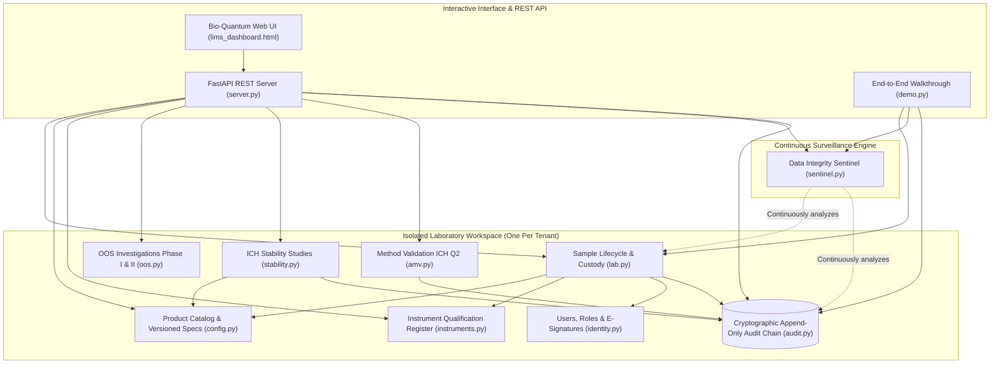
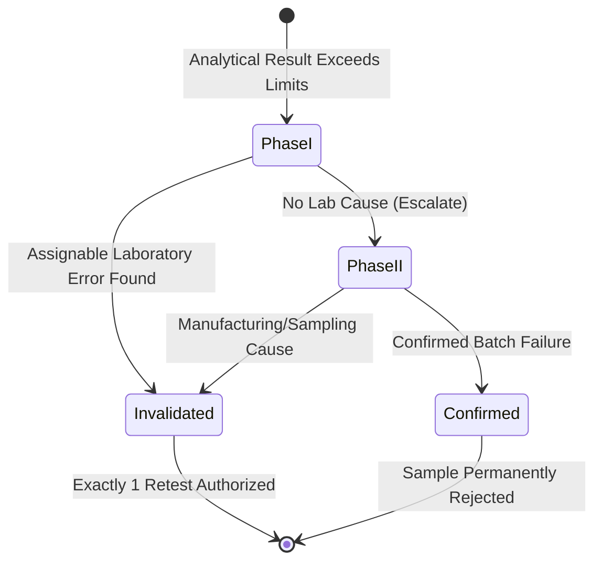

<div align="center">

# 🔬 LabSentinel LIMS
### Next-Generation GxP Laboratory Information Management System & Continuous Data Integrity Sentinel

[](https://python.org)
[](https://fastapi.tiangolo.com)
[](https://www.fda.gov)
[](tests/)
[]()
[](LICENSE)

<br/>

**A mission-critical, enterprise-ready LIMS core engineered for pharmaceutical, biotechnology, and chemical testing laboratories.**  
*Enforcing regulatory rigor, preventing "testing into compliance", and transforming passive audit trails into an active, continuous algorithmic radar.*

[Explore Features](#-key-features) • [Data Integrity Sentinel](#-the-data-integrity-sentinel) • [Interactive Web UI](#-bio-quantum-cyber-gxp-web-ui) • [Quickstart](#-quickstart) • [Architecture](#-system-architecture)

</div>

---

## 🌟 Executive Overview

In regulated laboratories subject to **FDA 21 CFR Part 11**, **EU GMP Annex 11**, and **ISO 17025**, laboratory data must be **Attributable, Legible, Contemporaneous, Original, and Accurate (ALCOA+)**. 

Conventional LIMS solutions treat audit logs as passive write-only storage that auditors inspect only after incidents occur. **LabSentinel LIMS** flips the paradigm:
1. **Mathematical Defense at the Core**: Pure AST-based safe formula calculation (zero `eval`), USP/EP pharmacopoeial half-up rounding, strict non-finite number filtering, and immutable specification pinning.
2. **Defensive GxP Lifecycle Enforcement**: Uncalibrated instruments cannot record results, passing results cannot be retested, segregation of duties is mathematically enforced, and OOS (Out-of-Specification) outcomes immediately trigger FDA-compliant Phase I/II investigations.
3. **The Data Integrity Sentinel**: An active automated surveillance engine that screens every result and audit record against statistical and behavioral patterns that inspectors target (duplicate high-precision numbers, digit bias, off-hours entries, and hash-chain breaks).
4. **Bio-Quantum Cyber-GxP Web UI**: An interactive, animated dashboard with real-time radar surveillance, live cryptographic seal verification, and sample custody pipelines.

---

## 🏛️ System Architecture



---

## 🔬 Key Features

### 1. Sample Lifecycle & Chain of Custody (`lims_core.lab`)
* **State Machine Pipeline**: Strict stage progression: `Registered` $\rightarrow$ `InTesting` $\rightarrow$ `UnderReview` $\rightarrow$ `Approved` / `Rejected`.
* **Segregation of Duties**: The analyst who generated sample data cannot review or approve the sample.
* **Specification Pinning**: Samples pin the exact specification version active during registration; retroactive spec updates never alter historic samples.

### 2. Tamper-Evident Certificate of Analysis (COA)
* Automatically derives released results with spec-level decimal precision.
* Seals the certificate with an immutable **SHA-256 document hash**.
* Any unauthorized post-release database alteration immediately breaks the cryptographic seal.

### 3. Safe Formula Engine & Pharmacopoeial Rounding (`lims_core.formula`)
* **Zero `eval()`**: Parses mathematical expressions into Abstract Syntax Trees with whitelisted arithmetic operators.
* **Pharmacopoeial Rounding**: Implements true **ROUND_HALF_UP** as required by USP $\langle 621 \rangle$ and European Pharmacopoeia (preventing banker's rounding bias).
* **Strict Real-Number Validation**: Rejects `NaN`, `+Inf`, and `-Inf` to prevent compliance bypass.

### 4. Instrument Qualification & Usability Gating (`lims_core.instruments`)
* Equipment register tracking calibration due dates and in-service statuses.
* **Hard Block**: Results cannot be entered on out-of-service or calibration-expired instruments.

### 5. Out-of-Specification (OOS) FDA Guidance Engine (`lims_core.oos`)

* **No Testing into Compliance**: Retesting a failed parameter is strictly blocked until QA completes an authorized investigation.

### 6. ICH Stability Testing Chambers (`lims_core.stability`)
* Long-term ($25^\circ\text{C}/60\%\text{ RH}$), Intermediate ($30^\circ\text{C}/65\%\text{ RH}$), and Accelerated ($40^\circ\text{C}/75\%\text{ RH}$) regimes.
* Matrix scheduler for months $0, 3, 6, 9, 12, 18, 24, 36$ tracking upcoming, due, pulled, and late pulls.

### 7. Analytical Method Validation ICH Q2 (`lims_core.amv`)
* **Repeatability**: Relative Standard Deviation ($\%RSD$).
* **Accuracy**: Recovery percentages across spiked levels.
* **Linearity**: 5-point calibration regression, slope, intercept, and determination coefficient ($R^2 \ge 0.999$).
* **LOD & LOQ**: Calculation from residual standard deviation and slope.

---

## 🛡️ The Data Integrity Sentinel

The **Data Integrity Sentinel** runs 10 pure, statistically validated detectors over result histories and audit chains:

| Detector | Pattern Flagged | Default Sensitivity Threshold | Risk Weight |
|---|---|---|---|
| **Testing Into Compliance** | A passing retest following an OOS result without an authorized QA investigation | Any occurrence | **HIGH (10 pts)** |
| **Duplicate Results** | Identical high-precision decimal values reported across different samples by one analyst | $\ge 3$ decimals across $\ge 3$ samples | **HIGH (10 pts)** |
| **Terminal-Digit Bias** | Chi-square ($\chi^2$) test detecting human digit preference (favoring $0$ or $5$) | $\chi^2 > 21.67$ ($p < 0.01$, $n \ge 50$) | **MEDIUM (4 pts)** |
| **Clustering at Limits** | Passing results disproportionately hugging the boundary ($\le 5\%$ of spec width) | $\ge 40\%$ of $10+$ results | **MEDIUM (4 pts)** |
| **Off-Hours Entry** | Results logged outside accredited working days/shifts (e.g. weekends) | $\ge 30\%$ of results | **MEDIUM (4 pts)** |
| **Implausibly Fast Entry** | Different sample results entered faster than manual lab operations allow | $< 20\text{s}$ apart ($\ge 3$ pairs) | **MEDIUM (4 pts)** |
| **Repeated Signature Failures** | Successive invalid e-signature password attempts (credential guessing) | $\ge 3$ failures in $15\text{ mins}$ | **HIGH (10 pts)** |
| **Missing Reason** | Critical actions (sample rejection, OOS conclusion) without mandatory notes | Any occurrence | **HIGH (10 pts)** |
| **Excessive Retesting** | Same parameter tested repeatedly across multiple attempts | $\ge 3$ attempts | **MEDIUM (4 pts)** |
| **Broken Audit Chain** | Hash-link discrepancy between sequential audit ledger entries | Any modification or deletion | **CRITICAL (10 pts)** |

---

## 💻 Bio-Quantum Cyber-GxP Web UI

The project features a **modern, responsive Web UI** styled in a high-tech **Bio-Quantum Cyber-GxP** aesthetic:

* 📡 **Live Animated Radar Scanner**: Continuous $360^\circ$ sweeping beam with glowing blip indicators and dynamic risk dial.
* 🔗 **Blockchain-Style Audit Visualizer**: Interactive cards showing block sequence, SHA-256 hashes, and real-time tamper-detection.
* 📜 **Interactive COA Release Certificate**: Official document view with real-time SHA-256 seal verification and tamper-simulation sandbox.
* 🧪 **Sample Pipeline & Formula Calculator**: Live formula evaluation with parameter inputs and instrument qualification checks.
* ⚡ **Dual-Mode Architecture**: Run via FastAPI backend (`python run_ui.py`) or open directly in any browser (`lims_dashboard.html`) with an embedded client-side simulation engine.

---

## 🚀 Quickstart

### Prerequisites
* Python 3.10+ (Tested through Python 3.13)
* `pytest` and `fastapi` / `uvicorn` (pre-installed or via pip)

### Installation
```bash
# Clone the repository
git clone https://github.com/DoshabHussain/lims-platform.git
cd lims-platform

# Install dependencies
pip install fastapi uvicorn pydantic pytest
```

### 1. Run the Test Suite (149 Tests)
```bash
python -m pytest -v
```

### 2. Run the End-to-End Walkthrough
```bash
python demo.py
```

### 3. Launch the Web UI & API Server
```bash
python run_ui.py
```
* **Interactive Dashboard**: [http://127.0.0.1:8000](http://127.0.0.1:8000)
* **Swagger API Documentation**: [http://127.0.0.1:8000/docs](http://127.0.0.1:8000/docs)

*(Alternatively, double-click [`lims_dashboard.html`](lims_dashboard.html) to run standalone with zero setup!)*

---

## 📂 Repository Structure

```
lims-platform/
├── src/
│   ├── lims_core/
│   │   ├── amv.py            # Analytical Method Validation (Precision, Accuracy, Linearity, LOD/LOQ)
│   │   ├── audit.py          # Append-only hash-chained SHA-256 audit ledger
│   │   ├── clock.py          # Deterministic FixedClock and SystemClock
│   │   ├── config.py         # Products, versioned specifications, parameter models
│   │   ├── container.py      # Multi-tenant workspace factory & isolation boundary
│   │   ├── entitlements.py   # Subscription tiers (Basic, Professional, Enterprise)
│   │   ├── errors.py         # Standardized GxP exception hierarchy
│   │   ├── formula.py        # Safe AST formula engine & pharmacopoeial rounding
│   │   ├── identity.py       # User directory, PBKDF2 hashing, 21 CFR Part 11 e-signatures
│   │   ├── instruments.py    # Instrument qualification, calibration gating, service states
│   │   ├── lab.py            # Sample lifecycle, results, review gate, COA generation
│   │   ├── oos.py            # Phase I & Phase II Out-of-Specification workflows
│   │   ├── sentinel.py       # Data Integrity Sentinel (10 statistical/behavioral detectors)
│   │   ├── server.py         # FastAPI REST API serving all LIMS operations
│   │   └── stability.py      # ICH stability studies, timepoint matrices, pull tracking
│   └── lims_ui/
│       └── index.html        # Bio-Quantum Cyber-GxP Web UI dashboard
├── tests/
│   ├── conftest.py                   # Reusable fixtures & mock lab setup
│   ├── test_config_instruments.py    # Specifications, versioning, instrument tests
│   ├── test_core_utils.py            # Formula, rounding, and audit link tests
│   ├── test_enhancements_and_bugfixes.py # Unit tests for bug fixes & API extensions
│   ├── test_lab.py                   # Full sample lifecycle & COA tests
│   ├── test_oos.py                   # Phase I & Phase II OOS verification
│   ├── test_platform.py              # Tenant isolation & entitlement gating
│   ├── test_sentinel.py              # Positive/negative detector test suite
│   ├── test_server.py                # REST API endpoint tests
│   └── test_stability_amv.py         # Stability schedules & validation statistics
├── demo.py                   # End-to-end executable walkthrough
├── DESIGN.md                 # In-depth architectural & compliance specifications
├── lims_dashboard.html       # Standalone portable dashboard
├── run_ui.py                 # Web application & REST server runner
└── pyproject.toml            # Project configuration & test paths
```

---

## 📋 Regulatory & Standards Compliance

| Standard / Guideline | Requirement | How LabSentinel LIMS Enforces It |
|---|---|---|
| **FDA 21 CFR Part 11** | E-signatures & Attributable Records | PBKDF2 hashed credentials, distinct signature meanings, and audit trail link. |
| **EU GMP Annex 11** | Audit Trail Integrity | Cryptographic SHA-256 hash chaining detects any insertion, modification, or deletion. |
| **FDA OOS Guidance** | Two-phase investigation before retesting | Hard programmatic block on retesting until Phase I/II is signed by independent QA. |
| **USP $\langle 621 \rangle$ / EP** | Half-Up Rounding | Pharmacopoeial rounding to specification decimals before limit evaluation. |
| **ICH Q1A (R2)** | Stability Testing Regimes | Automated pull schedules with early/late pull window enforcement. |
| **ICH Q2 (R1)** | Analytical Method Validation | Automated repeatability RSD, recovery accuracy, and $R^2 \ge 0.999$ linearity checks. |

---

## 📄 License

This project is licensed under the MIT License — see the [LICENSE](LICENSE) file for details.

---

<div align="center">
  <sub>Engineered with precision for defensible science by <b>Doshab Hussain</b>.</sub>
</div>
